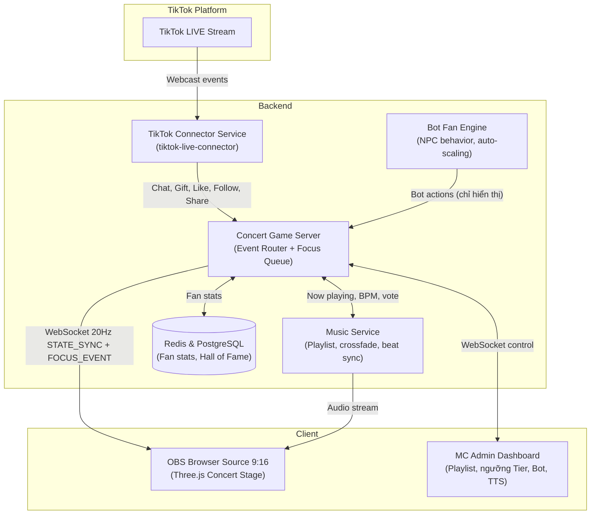

# 🎤 TÀI LIỆU THIẾT KẾ HỆ THỐNG & TRÒ CHƠI (GDD & TDD)
## Dự án: Đi Concert Tinh Hà Say Hi – TikTok LIVE Interactive Game (Mobile-First 9:16)

---

## 1. TỔNG QUAN DỰ ÁN (OVERVIEW)
- **Tên trò chơi:** Đi Concert Tinh Hà Say Hi – TikTok LIVE Interactive Concert
- **Thể loại:** Livestream Interactive Concert. Người xem "mua vé" vào một sân khấu concert 3D, cổ vũ Nhóm Tinh Hà biểu diễn, tặng quà để được camera "soi" và được mời lên sân khấu.
- **Định dạng hiển thị:** Khung hình dọc **9:16 (1080x1920)** cho TikTok Mobile (có tùy chọn 16:9).
- **Phong cách đồ họa:** 3D Cartoon/Chibi, sân khấu concert ngoài trời ban đêm, màn LED khổng lồ, laser, khói sân khấu, biển lightstick, pháo hoa.
- **Nhân vật trên sân khấu:**
  - **Nhóm Tinh Hà (mặc định, luôn biểu diễn):** Nhóm nhân vật 3D tự thiết kế, có phong cách giống concert Anh Trai Say Hi (trang phục sân khấu, tông màu, kiểu tóc, vũ đạo nhóm nam) nhưng là nhân vật riêng của game, có tên riêng, không mô phỏng gương mặt của nghệ sĩ thật nào.
  - **Anh Trai Say Hi (chỉ xuất hiện đặc biệt):** Chỉ xuất hiện khoảng **3s** khi có donate **Tier 3 hoặc Tier 4** (mục 4.1). Ngoài các lúc đó, Anh Trai không có mặt trên sân khấu. Cần xin phép trước khi dùng hình ảnh, tên thật của nghệ sĩ (xem mục 11).
- **Các bên tham gia:**
  - **Người xem (Viewers):** Comment, thả tim, follow, share, tặng quà.
  - **Bot Fan (NPC):** Khán giả ảo do hệ thống điều khiển, giữ concert luôn sôi động (mục 3).
  - **MC / Streamer:** Điều khiển concert, playlist, sự kiện qua Admin Dashboard.

---

## 2. BỐI CẢNH SÂN KHẤU CONCERT (VISUAL & LAYOUT)

```
┌────────────────────────────────────────────────────────┐
│ [9:16 Mobile Layout]                                   │
│ ┌────────────────────────────────────────────────────┐ │
│ │ 🎵 Now Playing: [Tên bản Remix] ▶ 01:24 / 03:10    │ │
│ ├────────────────────────────────────────────────────┤ │
│ │ 📺 MÀN LED KHỔNG LỒ (Giant LED Screen)             │ │
│ │ [Hiển thị avatar người được focus / visualizer]    │ │
│ ├────────────────────────────────────────────────────┤ │
│ │ 🎤 SÂN KHẤU CHÍNH (Main Stage)                     │ │
│ │   🕺 Tinh Hà 1   🕺 Tinh Hà 2   🕺 Tinh Hà 3 ...    │ │
│ │   ✨ [Cổng xuất hiện Anh Trai: chỉ 3s ở Tier 3/4]  │ │
│ │   ⭐ [Vị trí khách mời: fan Tier 4 lên sân khấu]   │ │
│ ├────────────────────────────────────────────────────┤ │
│ │ 🎫 KHU VIP / SVIP (sát sân khấu)                   │ │
│ │ 🎫 KHU GA (đứng)        🎫 KHÁN ĐÀI (ngồi)         │ │
│ │ [Biển avatar khán giả thật + Bot Fan cầm lightstick]│ │
│ ├────────────────────────────────────────────────────┤ │
│ │ 🏆 Top Fan phiên live   |  💬 Ticker comment       │ │
│ └────────────────────────────────────────────────────┘ │
└────────────────────────────────────────────────────────┘
```

### 2.1. Khu vực khán giả (Audience Zones)
| Khu | Ai được vào | Đặc điểm |
| :--- | :--- | :--- |
| **Khán đài** | Mọi người xem vào live / comment / like | Ghế bậc thang, avatar TikTok tròn |
| **GA** | Người comment `!vao` | Đứng gần sân khấu hơn, cầm lightstick |
| **VIP** | Người đã tặng tổng ≥ 100 xu trong phiên | Hàng đầu, lightstick phát sáng to hơn |
| **SVIP** | Top 3 Fan của phiên / VIP lâu năm | Sát mép sân khấu, có ghế riêng gắn tên |

- Thả tim: avatar giơ lightstick vẫy theo nhịp nhạc, bắn tim.
- Comment: bong bóng chat nhỏ hiện trên đầu avatar 2s.
- Share: pháo giấy tại chỗ đứng.

### 2.2. Render số lượng lớn
- Dùng **Three.js `InstancedMesh`** cho thân khán giả và lightstick (1 draw call), avatar dùng texture atlas.
- **Dynamic LOD:** chỉ avatar trong vùng camera đang soi mới tải ảnh độ phân giải cao.
- Mục tiêu: 60 FPS trên OBS với 1.000+ khán giả (thật + bot).

---

## 3. HỆ THỐNG BOT FAN TƯƠNG TÁC (NPC FAN ENGINE)

Mục đích: concert không bao giờ "vắng", kể cả lúc mới mở live hoặc ít người xem.

### 3.1. Hành vi Bot
| Hành vi | Mô tả |
| :--- | :--- |
| **Lấp chỗ trống** | Bot ngồi vào ghế trống ở khán đài/GA. Khi có người thật vào, bot nhường chỗ (người thật luôn được ưu tiên vị trí gần sân khấu hơn). |
| **Nhún nhảy theo nhạc** | Vẫy lightstick, nhảy theo BPM của bài đang phát (mục 5.3). |
| **Fan chant** | Đến đoạn điệp khúc, bot đồng loạt hô (chữ chạy trên màn hình), sóng lightstick lan từ trái sang phải. |
| **Phản ứng donate** | Khi có người thật tặng quà, bot quanh vị trí đó quay đầu, chỉ tay, vỗ tay, hiện bong bóng "Đỉnh quá!", "Chị đẹp ơi!". |
| **Bot chat** | Bong bóng chat mẫu ("Tinh Hà ơi nhìn em!", "Bài này cuốn quá!") hiển thị trong game. |
| **MC Bot** | Nhân vật MC ảo dẫn chương trình giữa các bài, giới thiệu bài tiếp theo, nhắc cú pháp comment. |

### 3.2. Điều tiết mật độ Bot (Auto-scaling)
- Mật độ hoạt động của bot tỉ lệ nghịch với tương tác thật:
  - `realEventsPerMinute < 10` → bot hoạt động 100%.
  - `10 – 60` → bot giảm còn 50%.
  - `> 60` → bot chỉ còn nhảy nền, không chat.
- Giới hạn: bot chat tối đa 1 bong bóng / 3s để không lấn át comment thật.

### 3.3. Quy tắc bắt buộc với Bot
- Bot **chỉ tồn tại trong đồ họa game**. Bot không phải tài khoản TikTok, không gửi comment lên TikTok, không tạo quà giả.
- Bot **không được tính** vào bảng xếp hạng, Top Fan, hay Hall of Fame.
- Avatar bot dùng ảnh minh họa chung (không dùng ảnh người thật) và có viền màu xám để phân biệt.
- Lý do: TikTok cấm tương tác giả (inauthentic engagement). Giữ bot hoàn toàn trong overlay giúp tránh vi phạm chính sách.

---

## 4. HỆ THỐNG FOCUS KHI NHẬN DONATE (DIRECTOR CAMERA)

### 4.1. Bảng 4 cấp Donate & Hiệu ứng Focus riêng

| Cấp | Giá trị (xu) | Ví dụ quà | Hiệu ứng Focus | Thời lượng |
| :--- | :--- | :--- | :--- | :--- |
| **Tier 1** (nhỏ nhất) | 1 – 9 | Hoa Hồng, TikTok | **ZOOM AVATAR NGAY LẬP TỨC:** Camera giật nhanh (0.3s) vào avatar người tặng tại chỗ đứng, avatar phóng to gấp 3, viền sáng hồng, tên hiện bên dưới. | 2.5s |
| **Tier 2** | 10 – 99 | Kem, Nước Hoa | **SPOTLIGHT:** Một cột đèn spotlight từ sân khấu chiếu thẳng xuống chỗ người tặng, avatar + tên hiện lên **màn LED khổng lồ**, khán giả xung quanh giơ lightstick về phía họ. | 3.5s |
| **Tier 3** | 100 – 499 | Corgi, Nước Ngọt, Mũ Lưỡi Trai | **ANH TRAI XUẤT HIỆN 3s:** Camera bay từ sân khấu ra khán giả; khói + ánh sáng tại cổng xuất hiện, **một Anh Trai** bước ra mép sân khấu, chỉ tay + bắn tim về phía người tặng trong **3s** rồi biến mất trong khói. Màn LED hiện "Cảm ơn @username". Người tặng được chuyển lên khu **VIP**. | 5s (Anh Trai có mặt 3s) |
| **Tier 4** (cao nhất) | ≥ 500 | Sư Tử, Tên Lửa, Vũ Trụ | **LÊN SÂN KHẤU:** Nhạc dừng 1 nhịp → đèn tắt toàn sân → spotlight vàng chiếu vào người tặng → avatar của họ được thang nâng đưa lên sân khấu. Ngay khi lên tới nơi, **các Anh Trai xuất hiện 3s** đứng quanh người tặng, cùng tạo dáng chào (hiệu ứng "chụp ảnh lưu niệm" đóng băng khung hình 0.5s), rồi rời đi trong pháo hoa. Người tặng tiếp tục nhảy điệp khúc cùng **Nhóm Tinh Hà**, TTS xướng danh, sau đó đứng ở **vị trí khách mời** đến hết bài. | 10s (Anh Trai có mặt 3s) + đến hết bài |

> Giả định: "giá trị cao thứ 4" được hiểu là cấp thứ 4, tức cấp cao nhất trong 4 cấp. Ngưỡng xu có thể chỉnh trong Admin Dashboard.

**Quy tắc xuất hiện của Anh Trai:**
- Anh Trai chỉ xuất hiện ở Tier 3 và Tier 4, mỗi lần đúng **3s** (`ANH_TRAI_APPEAR_SEC = 3`, chỉnh được trong Admin Dashboard).
- Tại một thời điểm chỉ có 1 lượt xuất hiện. Nếu nhiều Tier 3/4 đến cùng lúc, các lượt xuất hiện xếp hàng nối tiếp, Tier 4 được ưu tiên trước.
- Tier 3 gọi 1 Anh Trai (xoay vòng lần lượt từng người), Tier 4 gọi cả nhóm.
- Ngoài các lượt này, sân khấu chỉ có Nhóm Tinh Hà biểu diễn.

### 4.2. Cách tính giá trị donate
- Giá trị = `diamondCount × repeatCount` của gói quà.
- Với quà combo (streak), chỉ tính và phân cấp khi nhận sự kiện kết thúc combo (`repeatEnd = true`). Riêng Tier 1 vẫn zoom ngay ở lần đầu nhận quà để đảm bảo phản hồi tức thì, phần combo cộng dồn sau đó có thể nâng cấp lên Tier cao hơn.
- Cộng dồn trong 10s: nếu một người tặng nhiều quà nhỏ liên tiếp và tổng vượt ngưỡng tier cao hơn, kích hoạt hiệu ứng tier cao hơn.

### 4.3. Hàng đợi Focus (Focus Queue)
- **Tier 4** chen ngang mọi hiệu ứng khác (ngắt Tier 1–3 đang chạy, đưa phần còn lại vào hàng đợi).
- **Tier 3, Tier 2** xếp hàng theo thứ tự ưu tiên rồi thời gian.
- **Tier 1** không phải chờ: nếu camera đang bận với Tier 2–3, avatar Tier 1 hiện dạng **ô zoom nhỏ (Picture-in-Picture)** ở góc màn hình. Nếu có nhiều Tier 1 cùng lúc, gom thành lưới tối đa 4 ô.
- Nếu đã có fan Tier 4 trên sân khấu và có Tier 4 mới: tối đa 3 khách mời đứng cùng lúc, người vào trước nhất rời sân khấu (vẫy tay, xuống khu SVIP).

### 4.4. TTS xướng danh (theo cấp)
- **Tier 2:** *"Cảm ơn [@username] đã gửi [tên quà]!"*
- **Tier 3:** *"Anh Trai xuất hiện gửi lời cảm ơn tới [@username]!"*
- **Tier 4:** *"Xin mời [@username] bước lên sân khấu! Các Anh Trai đã ra chào đón!"*
- Tier 1 không đọc TTS (tránh ồn), chỉ có âm "ting" ngắn.

---

## 5. HỆ THỐNG NHẠC REMIX LIÊN TỤC (MUSIC PLAYLIST ENGINE)

### 5.1. Lưu ý bản quyền (quan trọng)
- **Bản remix không tự động hết bản quyền.** Một bản remix của bài hát có bản quyền vẫn là tác phẩm phái sinh, vẫn thuộc quyền của tác giả/hãng gốc, và hệ thống nhận diện âm thanh của TikTok vẫn có thể tắt tiếng hoặc cảnh báo phiên live.
- Chỉ đưa vào playlist những bản remix có **giấy phép hoặc sự cho phép bằng văn bản** (từ người làm remix và chủ sở hữu bài gốc), hoặc nhạc trong thư viện được phép dùng cho LIVE.
- Hệ thống bắt buộc mỗi bài phải có trường `license` (mục 5.4). Bài không có thông tin giấy phép sẽ không được phát.

### 5.2. Cơ chế chuyển bài liên tục
- **Auto-next:** Hết bài tự chuyển, **crossfade 3s** để không có khoảng lặng.
- **Giới hạn độ dài mỗi lượt:** mặc định phát tối đa 120s mỗi bài rồi chuyển (chỉnh được), giúp nhạc thay đổi liên tục.
- **Không lặp gần:** Một bài không được phát lại trong 5 bài tiếp theo.
- **Nhiều playlist theo chủ đề:** `Mở màn sôi động`, `Điệp khúc bùng nổ`, `Chill giữa giờ`, `Encore`. MC chọn playlist hoặc để chế độ tự động xoay vòng.
- **Khán giả vote bài:** Comment `!bai 1`, `!bai 2`, `!bai 3` trong 30s cuối bài để chọn bài tiếp theo trong 3 gợi ý hiển thị trên màn hình.
- **Tier 4 lên sân khấu:** Nhạc tự chuyển sang đoạn điệp khúc (theo `chorusStart`) để fan nhảy đúng đoạn cao trào.

### 5.3. Đồng bộ nhịp (Beat Sync)
- Mỗi bài có `bpm` và `chorusStart`. Animation nhảy của Nhóm Tinh Hà, nhịp vẫy lightstick, đèn laser và hiệu ứng bot đều đồng bộ theo BPM.
- Có thể phân tích beat tự động bằng Web Audio API (`AnalyserNode`) làm dự phòng khi thiếu metadata BPM.

### 5.4. Cấu trúc dữ liệu Playlist
```json
{
  "playlistId": "dieu-khuc-bung-no",
  "name": "Điệp khúc bùng nổ",
  "tracks": [
    {
      "trackId": "remix-001",
      "title": "[Tên bản Remix]",
      "remixer": "[Tên DJ/Producer]",
      "file": "audio/remix-001.mp3",
      "durationSec": 190,
      "bpm": 128,
      "chorusStart": 62.5,
      "license": {
        "type": "WRITTEN_PERMISSION",
        "proof": "licenses/remix-001.pdf",
        "allowedForLive": true
      }
    }
  ]
}
```

---

## 6. CÚ PHÁP TƯƠNG TÁC CỦA NGƯỜI XEM

| Hành động | Hiệu ứng |
| :--- | :--- |
| Vào phòng live | Nhận ghế ở khán đài, avatar xuất hiện |
| `!vao` | Chuyển xuống khu GA, nhận lightstick |
| `!light hong` / `!light xanh` / `!light vang` | Đổi màu lightstick |
| `!bai 1/2/3` | Vote bài tiếp theo |
| Thả tim | Avatar vẫy lightstick, bắn tim, cộng điểm "Độ cháy" cho sân khấu |
| Follow | Banner "Fan mới" + avatar được bắn pháo giấy |
| Share | Pháo giấy tại chỗ, +1 lượt cho thanh "Độ cháy" |
| Tặng quà | Hiệu ứng Focus theo Tier (mục 4) |

**Thanh "Độ cháy" sân khấu (Hype Meter):** Like + share + quà cộng dồn. Đầy thanh → kích hoạt sự kiện **"Bùng nổ"**: pháo hoa toàn sân, Nhóm Tinh Hà biểu diễn đoạn vũ đạo đặc biệt, nhạc chuyển sang bài trong playlist `Encore`.

---

## 7. LƯU TRỮ DÀI HẠN & HALL OF FAME

### 7.1. Chào đón Fan VIP khi vào live
- Lưu lịch sử đóng góp theo `uniqueId` (PostgreSQL + Redis cache).
- Fan đã từng tặng tổng ≥ 500 xu khi vào phòng: banner thảm đỏ chạy ngang, TTS *"Chào mừng Fan cứng [@username] đã trở lại concert!"*, tự động vào khu SVIP.

### 7.2. Bảng vàng Fan
```
┌────────────────────────────────────────────────────────┐
│ 🏛️ BẢNG VÀNG FAN CỨNG TINH HÀ SAY HI                   │
├────────────────────────────────────────────────────────┤
│ 1. 👑 @username_1  - 12 lần lên sân khấu (12.500 xu)   │
│ 2. ⭐ @username_2  -  6 lần lên sân khấu ( 6.800 xu)   │
│ 3. 💎 @username_3  -  4 lần lên sân khấu ( 4.200 xu)   │
└────────────────────────────────────────────────────────┘
```
- Top 1 tuần: tên hiện trên màn LED suốt phiên live tuần sau.
- Danh hiệu trên đầu avatar: `Fan Cứng`, `Khách Mời Sân Khấu`, `Trùm Lightstick`.
- Chỉ tính người xem thật. Bot không xuất hiện trong bảng.

---

## 8. TTS & CHỐNG SPAM ÂM THANH

- **Ưu tiên phát:**
  1. Tier 4 lên sân khấu (ngắt mọi câu khác, giảm nhạc nền còn 30% trong lúc đọc).
  2. Tier 3, sự kiện "Bùng nổ".
  3. Tier 2, chào Fan VIP.
  4. MC Bot giới thiệu bài mới.
- **Cooldown:** tối thiểu 5s giữa hai câu thường. Hàng đợi tối đa 5 câu, câu cũ ưu tiên thấp bị bỏ.
- **Ducking:** Nhạc tự giảm âm lượng khi TTS đọc, trả lại sau 0.5s.

---

## 9. KIẾN TRÚC KỸ THUẬT



### 9.1. Gói tin `FOCUS_EVENT`
```json
{
  "event": "FOCUS_EVENT",
  "timestamp": 1735689600120,
  "focusId": "focus-20260416-0012",
  "tier": 4,
  "effect": "STAGE_INVITE",
  "user": {
    "userId": "user_888",
    "uniqueId": "username_1",
    "nickname": "Fan Cứng 👑",
    "avatar": "https://p16-sign-va.tiktokcdn.com/..."
  },
  "gift": { "name": "Sư Tử", "diamondCount": 29999, "repeatCount": 1 },
  "durationSec": 10,
  "interrupt": true,
  "stageSlot": 2,
  "anhTraiAppearance": {
    "enabled": true,
    "members": "ALL",
    "durationSec": 3
  }
}
```
`anhTraiAppearance.enabled` chỉ là `true` với Tier 3 (`members` là 1 người) và Tier 4 (`members: "ALL"`). Tier 1 và 2 luôn là `false`.
Giá trị `effect` theo tier: `AVATAR_ZOOM` (1), `SPOTLIGHT` (2), `FAN_SERVICE` (3), `STAGE_INVITE` (4).

### 9.2. Gói tin `STATE_SYNC`
```json
{
  "event": "STATE_SYNC",
  "timestamp": 1735689600170,
  "concertState": "PERFORMING",
  "nowPlaying": {
    "trackId": "remix-001",
    "title": "[Tên bản Remix]",
    "positionSec": 84.2,
    "bpm": 128,
    "nextVoteOptions": ["remix-004", "remix-007", "remix-010"]
  },
  "hypeMeter": 0.72,
  "stageGuests": [
    { "userId": "user_888", "nickname": "Fan Cứng 👑", "slot": 2, "remainingSec": 95 }
  ],
  "focusQueueLength": 3,
  "audience": { "real": 420, "bots": 380 },
  "topFans": [
    { "uniqueId": "username_1", "totalCoins": 30500 }
  ]
}
```

---

## 10. THIẾT LẬP OBS STUDIO 9:16

1. **Settings → Video:** Base và Output `1080x1920`, `60 FPS`.
2. **Thêm Browser Source:** Width `1080`, Height `1920`, bật **"Control audio via OBS"** (để chỉnh riêng âm lượng nhạc và TTS).
3. **Camera MC:** Bật nền trong suốt (Alpha) trên Admin Panel, đặt camera MC ở góc dưới, như MC đang đứng ở khu VIP cổ vũ.

---

## 11. RỦI RO PHÁP LÝ & CHÍNH SÁCH CẦN XỬ LÝ TRƯỚC KHI LIVE

| Rủi ro | Biện pháp |
| :--- | :--- |
| **Bản quyền âm nhạc** (kể cả bản remix) | Chỉ phát bài có `license.allowedForLive = true`; lưu bằng chứng giấy phép. |
| **Hình ảnh / tên nghệ sĩ thật** | Nhóm Tinh Hà là nhân vật tự thiết kế: chỉ giống về phong cách, không mô phỏng gương mặt hay tên của nghệ sĩ thật. Lượt xuất hiện 3s của Anh Trai (Tier 3/4) vẫn là dùng hình ảnh nghệ sĩ, nên cần xin phép đơn vị quản lý. Nếu chưa xin được, thay bằng hình bóng (silhouette) hoặc nhân vật cách điệu không nhận diện được. |
| **Tên chương trình "Say Hi"** | Kiểm tra quyền sử dụng tên/logo của chương trình gốc trước khi dùng trong tiêu đề live. |
| **Tương tác giả** | Bot chỉ hiển thị trong game, không tạo comment/quà trên TikTok, không tính vào bảng xếp hạng (mục 3.3). |
| **tiktok-live-connector là thư viện không chính thức** | Có thể ngừng hoạt động khi TikTok thay đổi giao thức; chuẩn bị chế độ chạy tay cho MC trên Admin Dashboard. |
